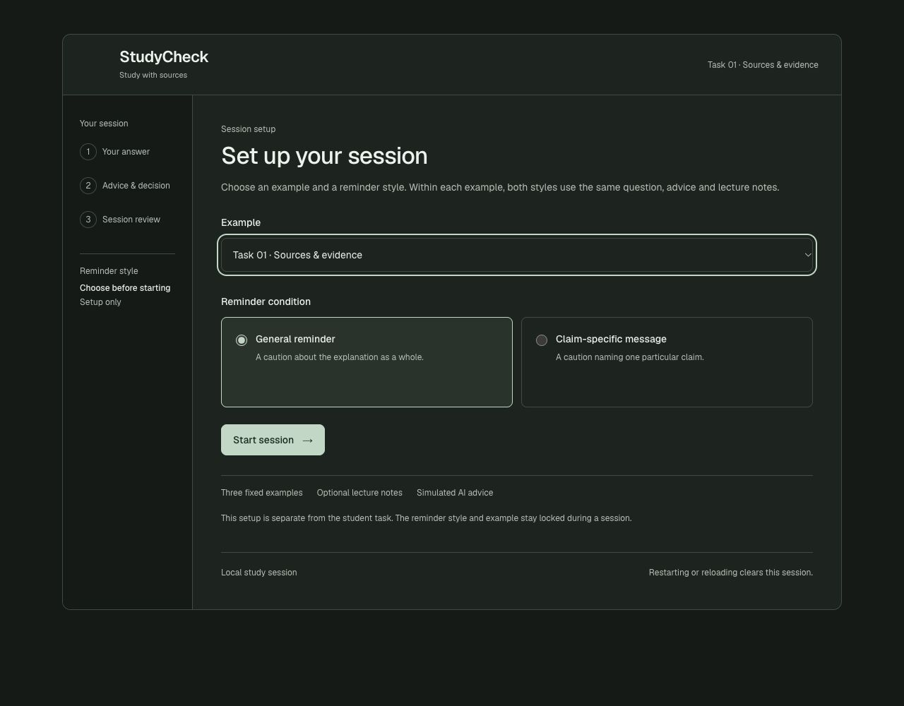

# StudyCheck

README prose word count: 961

**Hassan Umar Hassan** · MSc Intelligent Interactive Systems · University of Birmingham

StudyCheck is a prototype for checking AI study advice against lecture notes. It develops the question raised in my A1 literature review: could a warning about a particular claim help students check an answer more effectively than a general reminder?

The app demonstrates that interaction. It does not test whether either warning improves learning or verification.



## Project status

Three examples use the same citation-support question:

- **Task 01:** incorrect advice recommends Yes; the claim-specific message names the unsupported claim.
- **Task 02:** correct advice recommends No, with no targeted flag. Both conditions show the same general reminder.
- **Task 03:** correct advice recommends No, but the claim-specific message questions a supported claim. This demonstrates a false alarm.

The student chooses a condition before starting, saves an initial answer, sees the advice, optionally opens notes and submits a final answer. The review shows the saved choices, notes access and agreement with the answer key. Within each example, the question, advice, notes and controls stay identical between warning conditions. The condition is locked during the session.

Advice and claim flags are scripted. There is no live AI model, automatic error detector or retrieval service. Records stay in browser memory and clear on restart or refresh. Opening notes does not prove they were read; changing an answer does not establish learning or a warning effect. No participant study has been conducted.

The application, system diagram and illustrated examples are included in this [repository](https://github.com/NabsCodes/studycheck). The project report is prepared separately for Canvas; no accompanying ZIP is needed.

## Run locally

Use Node.js 22.13 or newer and pnpm 10.2.0. If needed, install pnpm with `npm install --global pnpm@10.2.0`.

```bash
git clone https://github.com/NabsCodes/studycheck.git
cd studycheck
pnpm install --frozen-lockfile
pnpm dev --hostname 127.0.0.1
```

Open the URL printed in the terminal, normally <http://127.0.0.1:3000>. Stop the server with Ctrl+C. To inspect a production build:

```bash
pnpm build
pnpm start --hostname 127.0.0.1
```

No API keys or environment file are needed. Installation and compilation need internet access for dependencies and the Geist font loaded through `next/font/google`. The original lecture link requires university access; the adapted notes are included in the app.

## Try the interaction

1. Choose **Task 01** and **General reminder**, then start.
2. Select **Yes** and save the initial answer. The simulated advice recommends Yes.
3. Open the notes, compare the claim with the passage, select **No** and submit.
4. Check that review preserves the initial Yes, final No and notes access. Expand **See the recorded actions** to inspect the sequence.
5. Restart and repeat with **Claim-specific message** to compare the wording.

Task 02 demonstrates correct advice without a targeted warning. For Task 03, choose **Claim-specific message**, save No and submit No. Review identifies the false alarm even when the final answer is correct. The [illustrated examples](docs/illustrated-examples.html) include a separate, deliberately scripted Task 03 path ending in Yes; that screenshot is not a participant result.

**Not sure** is available throughout. Trying to save an empty initial answer shows an error. The final selection starts from the initial answer and requires explicit submission. Replaying a question whose answer has been revealed demonstrates the software; it is not an independent study trial. The [manual check guide](docs/manual-check.md) gives additional expected results.

## Technical structure

Next.js provides the page and assets; React handles the interaction. TypeScript defines answers, stages and events. Tailwind styles the screens, and native radios and buttons provide the controls. pnpm manages dependencies; Vitest tests the transition logic.

- [`components/study/`](components/study/) renders setup, answers, notes and review. The workspace resets session state when the example changes.
- [`content/scenarios.ts`](content/scenarios.ts) holds the versioned question, advice, warnings, notes, source details and answer keys.
- [`hooks/use-study-session.ts`](hooks/use-study-session.ts) connects controls and presentation events to the session state.
- [`lib/study-session.ts`](lib/study-session.ts) guards transitions and preserves committed answers. [`lib/advice-review.ts`](lib/advice-review.ts) checks the advice and warning against the key.

This scope needs no authentication or database. Session events record task/content versions, condition, choices and elapsed action times. Elapsed time does not measure active study time.

The [system diagram and architecture notes](docs/architecture-and-examples.md) explain the component boundaries. Open the illustrated-example HTML with its adjacent assets to inspect the diagram, three annotated walkthroughs and original screenshots.

## Development and checks

The [development record](docs/development-record.md) explains significant decisions, corrections and checks. Development included replacing the focus effect with a keyed heading and callback ref to retain stage focus without the effect, using standard Next.js font loading after my feedback, and replacing schematic summaries with screenshots so the notes and submission controls can be inspected. Git milestones include [the first complete task](https://github.com/NabsCodes/studycheck/commit/13fb206), [interface refinement](https://github.com/NabsCodes/studycheck/commit/ffd4525) and [font changes](https://github.com/NabsCodes/studycheck/commit/fd7d9bc).

On 25 November 2026, formatting, lint, types, all ten tests and the production build passed. A fresh clone of the application at commit `b261798` installed from the lockfile, passed the tests, built and served successfully.

```bash
pnpm format:check
pnpm lint
pnpm typecheck
pnpm test
pnpm build
```

One test checks answer preservation across 108 combinations. Other tests cover condition locking, duplicate/stale events, notes access and reset isolation. Earlier browser walkthroughs checked both conditions, keyboard/focus behaviour and narrow screens; their dates and results are in the development record. These are developer checks, not participant findings or complete accessibility certification. Hassan confirmed Task 01 separately.

## Sources and AI use

The notes paraphrase `W04_L11_Retrieval_Grounding_and_Provenance.pdf`, PDF pages 5, 8 and 10. [Task 01 notes](docs/task-01.md) link the original lecture and explain the answer key. [Tasks 02–03 notes](docs/task-02-03.md) explain the baseline and false alarm. The lecture PDF is not redistributed.

I supplied the A1 foundation, approved the direction and interaction, requested revisions, confirmed Task 01 and reviewed the report. OpenAI Codex generated the application code and tests, prepared the wireframes, diagram and screenshot walkthroughs, drafted the documentation/report and ran the recorded checks. The development record documents changes and verification, including the focus, font and screenshot revisions above. I remain responsible for the final submission.

My Dikko & Mahmoud, Party Gift Pass, Vextra and WardWise projects informed the organisation and interaction patterns; their business code and assets were not copied. The source-page icon was created with Codex assistance.
